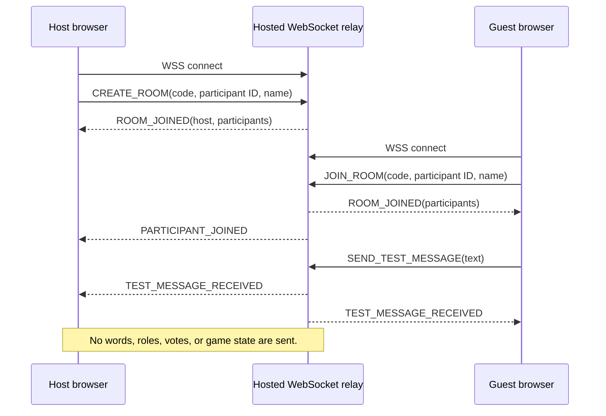

# Multiplayer Phase 1: Architecture and Feasibility

Audit date: 2026-10-23. This note describes the repository checkout and the isolated connection proof; it does not claim physical-device or production connectivity.

## Application audit

- The app is React 19 + TypeScript + Vite. `src/main.tsx` mounts one `App`; `App.tsx` owns screen navigation and the local game state with React hooks. There is no shared state store or router.
- Game screens use string phases (`setup`, `reveal`, `discussion`, `voting`, `result`) and player IDs. `src/lib/game.ts` normalizes players, randomly chooses a word and assigns roles, and validates votes. `Word` data is typed in `src/data/types.ts`; category banks are composed from `src/data/bank/`.
- The word bank is bundled with the frontend. Settings and custom/imported words are stored in browser `localStorage`; an active round, secret word and roles remain in React memory. The existing one-device flow includes sequential private reveals, a discussion timer, private sequential voting, and results.
- The Multiple Mobiles screen in `App.tsx` retains a mock gameplay-room preview. The separate connection proof in `src/multiplayer/` tests room membership and harmless text only. It is not a playable multiplayer game.
- Tests use Vitest with jsdom by default. TypeScript is strict; ESLint applies to TypeScript and TSX. Scripts are `npm test`, `npm run lint`, `npm run typecheck`, and `npm run build` (which also runs `tsc -b`).
- The frontend stores settings and user words locally. Game roles and words are not persisted or synchronized. The current relay does not receive any game data.
- The repo assumes root-hosted Vite assets and fetches fonts from Google Fonts. It contains no verified production hosting configuration or deployed relay URL. HTTPS/WSS deployment is therefore not confirmed; browsers require secure WebSockets for HTTPS pages.

## Mode B decision

Use an authoritative hosted WebSocket relay for room membership and eventual game state. For this phase, the Node `ws` server owns temporary room membership, assigns the host flag, checks each action against the connected socket, and relays test messages. The frontend’s existing screens and word data remain untouched by the transport boundary.

| Option | Network reach | Complexity and cost | Privacy and recovery | Decision |
| --- | --- | --- | --- | --- |
| Hosted WebSocket server | Every device makes an outbound WSS connection, so same Wi-Fi and mixed/mobile networks use the same path. The service must be publicly reachable. | One small Node service to deploy, monitor and scale; hosting and bandwidth costs depend on provider and use. | Server can validate participants and later own game state/private messages. Reconnection and host recovery are explicit server responsibilities. | Selected: simplest model for small text messages and future authoritative game state. |
| WebRTC data channels | ICE can form direct paths on many networks, including local candidates on the same LAN. Some NATs/firewalls prevent a direct pair. | Requires signaling plus ICE configuration and operationally reliable STUN/TURN services. TURN relays traffic when direct connectivity fails and adds bandwidth cost. | Peer state makes authoritative rules and host-loss recovery harder. Data channels are encrypted in transit, but role secrecy still depends on protocol design. | Not selected: unnecessary peer negotiation and relay fallback for tiny game events. STUN alone cannot guarantee a path. |
| Managed realtime service | Similar outbound realtime connections across networks; delivery still depends on provider availability and quotas. | Less socket-server operations, but requires a vendor project, policies/configuration and usage monitoring. Current Supabase docs list 200 peak connections and 2 million messages on Free; paid plan and overage costs can apply. | Presence and broadcast simplify membership and fanout, but authorization policies still need careful design; a publishable client key is not authorization by itself. | Viable later if avoiding server operations is worth vendor dependence; not materially simpler for this proof. |

The relay is authoritative only for this proof’s room actions, not for gameplay. A Phase 2 game should make the server authoritative for phase transitions, random role assignment and voting, and send each participant only the role payload they are allowed to see. A client-provided room code is an invitation token, not strong identity or authentication.

### Connection and message flow

The browser generates a UUID participant ID and a six-character random room suffix. The server rejects a duplicate ID in a room, rejects a socket joining multiple rooms, and requires the matching room and participant for send/leave. Room state is in memory and expires after four hours. A disconnect removes that participant; if the host leaves, the oldest remaining participant becomes host and receives a host-change event. The client reports the disconnect and currently requires a fresh join; there is no resume token or grace period.

Room code, participant ID/name, host status, and test text are public to the room and visible to the relay. No secret word, role, vote, or actual game data may be sent over this proof protocol. The server imposes payload, room capacity, active-room and per-connection message limits. It has no account authentication, durable state, IP-based abuse controls, or origin allowlist, so it is a development proof rather than a public production service.

## Setup and operations

- Local relay: `npm run server` starts Node on port 3001; `/health` reports service health and current room count. For a phone on the same LAN during development, configure the page to use the computer’s LAN address. This is still a development setup and depends on firewall/network settings.
- Cross-network Mode B requires a publicly reachable Node WebSocket service with TLS. Configure the frontend build variable `VITE_MULTIPLAYER_SERVER_URL=wss://<relay-host>`; HTTPS pages cannot use insecure `ws://`. No credentials or external account are needed by the code itself. A hosting account and a TLS-capable Node host are required to make the proof available on the public internet.
- No managed service is provisioned. A small self-hosted relay avoids adding an ongoing vendor dependency, but its host, uptime, monitoring, bandwidth and scaling have costs that depend on the chosen provider. Supabase Realtime is a reasonable managed alternative; its documented Free quota is 200 peak connections and 2 million Realtime messages, with inactivity pausing free projects. Its current billing documentation describes paid tiers and message overages; verify current pricing before adoption.

## Mode C feasibility

A browser-only implementation cannot promise nearby offline connectivity across iPhone and Android. Web Bluetooth is secure-context-only and has limited browser availability; it is not a shared cross-platform browser transport to build this feature on. WebRTC still needs a signaling exchange to introduce peers, and same-room/no-internet setup must supply that signaling locally; TURN solves relaying when peers cannot connect directly but itself needs reachable infrastructure.

Native options expose capabilities browsers do not:

- Android provides Network Service Discovery and Wi-Fi P2P APIs, and Google Play Services Nearby Connections offers a higher-level nearby connection path. These require a native Android app, runtime nearby-device permissions, and compatible Google Play Services where applicable.
- Apple documents Wi-Fi Aware as peer-to-peer communication without an access point or internet, for supported devices (iPhone 12 and later in its current framework documentation). It requires native APIs, service declarations, pairing UX and the Wi-Fi Aware entitlement. Apple’s older Multipeer Connectivity framework is deprecated in current Apple documentation, so avoid selecting it without a fresh lifecycle review.
- Android Wi-Fi Direct/Nearby Connections and Apple Wi-Fi Aware/Network APIs are platform-specific. A shared wire format does not make their discovery, permissions or transports interoperable. A native shell would need platform-specific modules; a browser web app alone cannot call these APIs directly. QR can carry room/pairing data, but it does not create a network connection.

**Recommended experiment:** build a tiny native iOS harness and test two iPhone 12+ devices on a supported iOS release with Wi-Fi Aware. Exchange a short random token and a test message after user-approved pairing, with no internet and no shared access point. This requires two physical devices, Xcode signing, Apple’s Wi-Fi Aware entitlement, declared services, and device discovery/pairing permissions. It validates only Apple-to-Apple operation; a separate Android harness and cross-platform transport experiment remain necessary before claiming Android/iPhone support.

## Validation limits and next phase

Automated tests cover protocol parsing/sanitization, connection-proof UI behavior using an in-memory mock, room registry membership rules, and a real loopback WebSocket relay round trip. The loopback test does not establish cross-network reliability. No physical Android/iPhone test or hosted relay test has been performed in this phase.

Phase 2 should first add a deployable TLS endpoint and real-browser two-client test, then add server-owned game sessions, authenticated/recoverable participant identity, reconnect grace periods and targeted role delivery. Keep game words and roles server-side and never broadcast them to the whole room.

## References

- [WebSocket client security and mixed content](https://developer.mozilla.org/en-US/docs/Web/API/WebSockets_API/Writing_WebSocket_client_applications#security_considerations)
- [WebRTC connectivity and ICE candidates](https://developer.mozilla.org/en-US/docs/Web/API/WebRTC_API/Connectivity)
- [WebRTC protocols: ICE, STUN and TURN](https://developer.mozilla.org/en-US/docs/Web/API/WebRTC_API/Protocols)
- [Web Bluetooth API availability and secure-context requirements](https://developer.mozilla.org/en-US/docs/Web/API/Web_Bluetooth_API)
- [Android wireless and nearby connectivity APIs](https://developer.android.com/develop/connectivity/wifi)
- [Apple Wi-Fi Aware](https://developer.apple.com/documentation/WiFiAware)
- [Apple Wi-Fi API options and iOS peer-to-peer constraints](https://developer.apple.com/documentation/technotes/tn3111-ios-wifi-api-overview)
- [Apple’s Multipeer Connectivity migration note](https://developer.apple.com/documentation/technotes/tn3213-moving-from-multipeer-connectivity-to-network-framework)
- [Supabase Realtime overview](https://supabase.com/docs/guides/realtime)
- [Supabase Realtime limits](https://supabase.com/docs/guides/realtime/limits)
- [Supabase Realtime billing](https://supabase.com/docs/guides/platform/manage-your-usage/realtime-messages)
